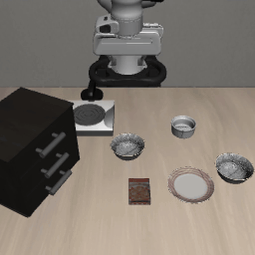
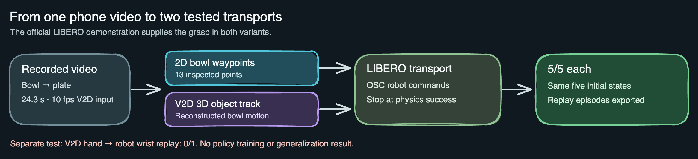

*My bowl-to-plate demonstration, sped up to match the full V2D object-guided LIBERO replay. Both sequences now show the bowl being placed and the hand or gripper releasing it. The robot uses an official demonstration for its grasp and release.*

# Phone Video to LIBERO Bowl Placement

Submission for the Humanoid Robot Learning Research Internship challenge.

## Overview

I am Rohith, a first-year undergraduate student in Canada. I recorded several
black-bowl-to-plate demonstrations for this challenge and used one recording
to guide a LIBERO robot's transport motion. The repository contains the tested
video-guided replays, an experimental V2D hand-retargeting route, and the
results and limitations of each.

## Full simulated robot replay



[Watch the full replay with external and wrist cameras](docs/media/full_libero_bowl_placement.mp4).
The MP4 contains all 239 steps of a successful 11.95-second V2D object-guided
rollout at 20 Hz. The inline GIF shows the full external-camera sequence at
10 fps. My video guides transport; an official LIBERO demonstration supplies
the grasp and release command. After release, 36 scripted steps hold the
gripper open and lift it clear. The bowl remains on the plate at the final
physics check ([metrics](docs/v2d_full_release_metrics.json)).

I measured bowl centers at selected timestamps (my hand occludes some frames)
and saved those measurements in
[`data/derived/bowl_to_plate_waypoints.csv`](data/derived/bowl_to_plate_waypoints.csv).
[`scripts/video_guided_replay.py`](scripts/video_guided_replay.py) uses the
horizontal displacement to control the robot's transport progress, vertical
image motion to modulate lift height, and timestamps to set transport speed.
An official LIBERO demonstration supplies the grasp and other non-transport
actions. The video replaces its transport actions with OSC commands. The
original five-run evaluation stops at first physics success; the full replay
above continues through release and retreat.

[Watch a 19-second clip of my bowl-to-plate demonstration](docs/media/bowl_to_plate_demonstration_excerpt.mp4).
The full-resolution recording remains private; this public clip has no audio or source
metadata.

On the first five official initial demonstrations of
`libero_spatial/pick_up_the_black_bowl_from_table_center_and_place_it_on_the_plate`,
**5/5 video-guided rollouts passed `env.check_success()`**. The resulting HDF5
files contain simulator images, robot state, and actions. See
[`docs/results.md`](docs/results.md) and
[`docs/video_guided_metrics.json`](docs/video_guided_metrics.json).
Using V2D's reconstructed 3D bowl track for transport also passed **5/5** on
those states; its [metrics](docs/v2d_object_metrics.json) and
[derived object positions](data/derived/bowl_to_plate_v2d_object_track.csv) are
included. Both variants retain the official grasp and post-transport actions
up to the first physics success.
Unmodified expert actions on those same five initial states also passed 5/5
in 98.0 mean steps, versus 197.4 for the video-guided replay. This control
isolates the change to the transport phase; it does not demonstrate an
improvement over the expert.


This demonstrates video-driven transport in the simulator. It does not establish
a policy trained from video or a complete video-only grasp. The full
hand-and-object reconstruction route through NVIDIA V2D is documented in the
[reproduction guide](docs/reproduction.md).

## Example outputs



[Editable Excalidraw source](docs/media/pipeline.excalidraw).


*Upright-constrained visualization: cyan is the approximate bowl mesh, with its opening set to gravity-up; magenta is V2D's MANO hand pose. V2D's original bowl rotation [flips upside down](docs/media/v2d_reconstruction_stills.png) near placement, so the corrected rotation is an explicit assumption, not a recovered pose. The original V2D bowl positions are unchanged.*

| Video-guided LIBERO result | V2D object-guided LIBERO result |
|:---:|:---:|
|  |  |

The [2D replay metrics](docs/video_guided_metrics.json), [V2D object replay metrics](docs/v2d_object_metrics.json), and [V2D-derived bowl positions](data/derived/bowl_to_plate_v2d_object_track.csv) are included. Successful runs also write HDF5 episodes with both simulator camera views, robot state, and actions; those larger files remain local.

## Design choices and lessons

- **Why this task:** My bowl-to-plate recording matches a LIBERO task with a physics success check. I inspected sparse 2D bowl waypoints because my hand occludes the bowl in some frames, then tested V2D's 3D bowl track as a second transport signal.
- **Why use an expert grasp:** Keeping task-matched expert actions outside transport isolates the contribution of my video's motion. [More design detail](docs/design.md).
- **What worked:** Both video-driven transport variants passed 5/5 replays on the same five official initial states. The unmodified expert also passed 5/5, so this is not evidence of better performance or generalization.
- **What did not:** Direct V2D hand-to-robot replay failed once because the gripper missed the bowl. V2D's estimated bowl orientation flips near placement, and wrist-to-tool pose and workspace yaw need calibration. The successful object-guided transport uses bowl *position*, not that faulty rotation. The display correction is reproducible with [`scripts/constrain_v2d_bowl_upright.py`](scripts/constrain_v2d_bowl_upright.py); it does not change the replay metrics. [Failure frames](docs/media/v2d_direct_replay_fail_montage.png) and [full results](docs/results.md). No policy fine-tuning or evaluation has been run.

## Reproduction

Install [LIBERO](https://github.com/Lifelong-Robot-Learning/LIBERO) and its
requirements, then download its `libero_spatial` demonstration dataset. The
script reads the single task file
`pick_up_the_black_bowl_from_table_center_and_place_it_on_the_plate_demo.hdf5`.
LIBERO's source checkout needs to be on `PYTHONPATH`; on a Linux headless host:

```bash
export PYTHONPATH=/absolute/path/to/LIBERO:$PWD
export MUJOCO_GL=egl
python scripts/video_guided_replay.py \
    --config configs/target.yaml \
    --expert-hdf5 /absolute/path/to/pick_up_the_black_bowl_from_table_center_and_place_it_on_the_plate_demo.hdf5 \
    --episodes 5 --out-dir data/video_guided_replay
```

Use `--mode v2d` for reconstructed bowl positions or `--mode expert` for
an unchanged expert control; choose a different `--out-dir` for each run.
The script writes metrics, final renders, and HDF5 episodes for successful
rollouts. See the [full reproduction guide](docs/reproduction.md) for V2D setup,
retargeting, data conversion, and the limits of each route.

## Repository layout

| Path | Contents |
|---|---|
| `v2d_to_libero/` | V2D pose extraction, calibration, and robot retargeting |
| `scripts/` | Replay, reconstruction wrapper, convention checks, and data conversion |
| `configs/` | Task and calibration settings |
| `data/derived/` | Public bowl waypoints and reconstructed object positions |
| `data/meshes/` | Approximate bowl proxy used for V2D tracking |
| `docs/` | Results, design notes, reproduction steps, metrics, and media |
| `tests/` | Unit checks for the adapter and upright visualization |

## Current status

| Part | What the result means |
|---|---|
| Video-guided transport | Both the measured 2D waypoints and V2D bowl positions succeeded in 5/5 replays on the same five official initial states. Those episodes ended at first physics success. A separate V2D-guided replay continued through release and retreat (1/1). |
| V2D reconstruction | Processed 243 frames, but early hand poses were filled before the hand entered, and the estimated bowl rotation flips near placement. |
| Direct hand-to-robot replay | Adapter implemented; the first replay missed the bowl (0/1). Wrist-to-tool calibration is still needed. |
| LeRobot dataset conversion | Converter implemented; a converted dataset still needs end-to-end validation. |
| Policy training and evaluation | Not run. The replay results do not establish a trained-policy benefit. |

See [`docs/results.md`](docs/results.md) for measured outcomes and failures.

## Requirements & data notes

- **MANO models are licensed separately** — put `MANO_RIGHT.pkl` / `MANO_LEFT.pkl`
  in a local dir (e.g. `~/Downloads/mano_v1_2/models/`) and point
  `mano_model_dir` at it. They are never committed.
- The full-resolution source video, MANO weights, and HDF5 outputs are not
  committed. The authorized excerpt, derived waypoint CSV, metrics, and a
  final simulator render are committed.

## Acknowledgments

- [NVIDIA V2D](https://github.com/nvidia-isaac/video_to_data) —
  reconstruction pipeline; `mano.py` adapted from its Apache-2.0 sources.
- [LIBERO](https://github.com/Lifelong-Robot-Learning/LIBERO) — benchmark & sim.
- [openpi](https://github.com/Physical-Intelligence/openpi) / π0,
  [OpenVLA-OFT](https://github.com/siddhanthaldar/OpenVLA-OFT) — policies.

## License

MIT (see `LICENSE`; V2D-derived files keep their Apache-2.0 headers, see
`NOTICE`).
