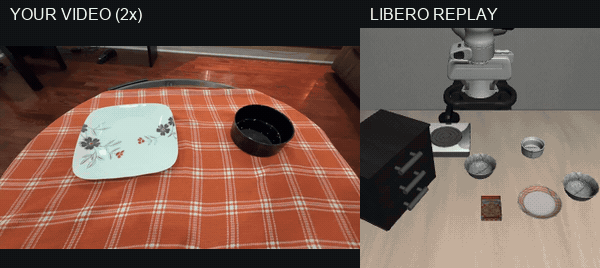
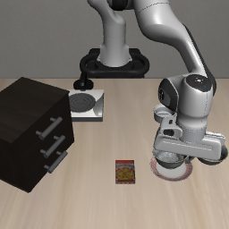
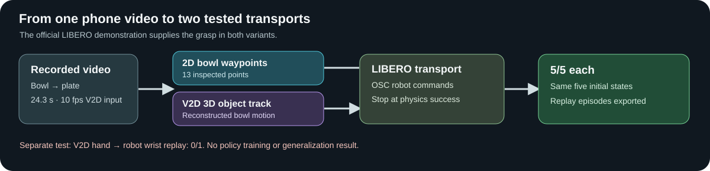
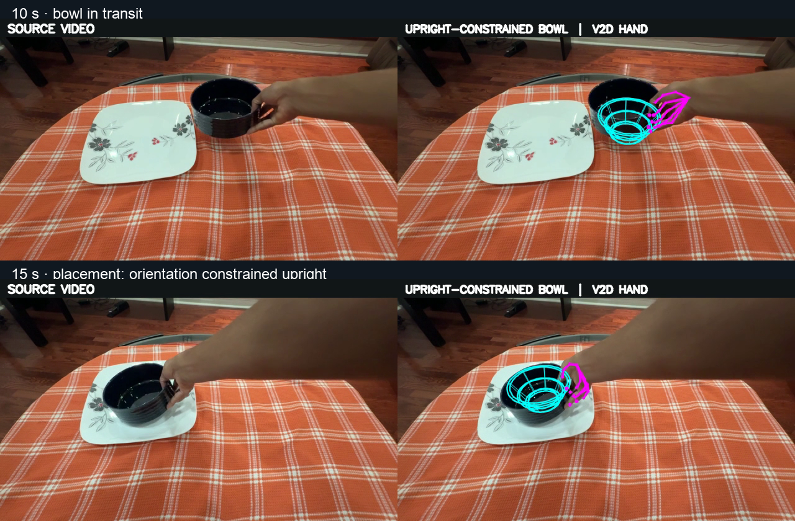
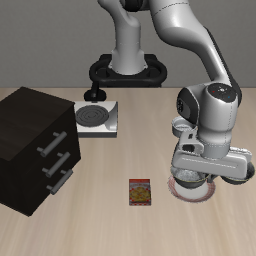

*My bowl-to-plate demonstration, shown at 2× speed, beside its V2D object-guided LIBERO replay. The robot uses an official demonstration for grasp and release.*

# Phone Video to LIBERO Bowl Placement

Submission for the Humanoid Internship role!
## Preface

Hello Humanoid Team, my name is Rohith and I am a first year undergrad student in Canada. Over the last two months or so, I've been working on a pipeline that takes egocentric video data and uses NVIDIA's CHORD to transfer a dexterious manipulation policy to a real robot. I wanted to use some of that work and showcase what I've been doing for the past couple of weeks! For the initial data, I did many takes of picking a black bowl moving it onto a plate.

We measured bowl centers at selected timestamps (the hand occludes some frames)
and saved those measurements in
[`data/derived/IMG_7805_bowl_waypoints.csv`](data/derived/IMG_7805_bowl_waypoints.csv).
[`scripts/video_guided_replay.py`](scripts/video_guided_replay.py) uses the
horizontal displacement to control the robot's transport progress, vertical
image motion to modulate lift height, and timestamps to set transport speed.
An official LIBERO demonstration supplies grasp and release. The video replaces
its transport actions with OSC commands.

[Watch a 19-second clip of my bowl-to-plate demonstration](docs/media/IMG_7805_excerpt.mp4).
The full-resolution recording remains private; this public clip has no audio or source
metadata.

On the first five official initial demonstrations of
`libero_spatial/pick_up_the_black_bowl_from_table_center_and_place_it_on_the_plate`,
**5/5 video-guided rollouts passed `env.check_success()`**. The resulting HDF5
files contain simulator images, robot state, and actions. See
[`docs/results.md`](docs/results.md) and
[`docs/video_guided_metrics.json`](docs/video_guided_metrics.json).
Using V2D's reconstructed 3D bowl track for transport also passed **5/5** on
those states; its [metrics](docs/v2d_object_metrics.json) and
[derived object positions](data/derived/IMG_7805_v2d_object_track.csv) are
included. Both variants retain the official grasp and release.
Unmodified expert actions on those same five initial states also passed 5/5
in 98.0 mean steps, versus 197.4 for the video-guided replay. This control
isolates the change to the transport phase; it does not demonstrate an
improvement over the expert.



This demonstrates video-driven transport in the simulator. It does not establish
a policy trained from video or a complete video-only grasp. The full
hand-and-object reconstruction route through NVIDIA V2D is a separate experiment
below.

## Example outputs





*Upright-constrained visualization: cyan is the approximate bowl mesh, with its opening set to gravity-up; magenta is V2D's MANO hand pose. V2D's original bowl rotation [flips upside down](docs/media/v2d_reconstruction_stills.png) near placement, so the corrected rotation is an explicit assumption, not a recovered pose. The original V2D bowl positions are unchanged.*

| Video-guided LIBERO result | V2D object-guided LIBERO result |
|:---:|:---:|
|  |  |

The [2D replay metrics](docs/video_guided_metrics.json), [V2D object replay metrics](docs/v2d_object_metrics.json), and [V2D-derived bowl positions](data/derived/IMG_7805_v2d_object_track.csv) are included. Successful runs also write HDF5 episodes with both simulator camera views, robot state, and actions; those larger files remain local.

## Design choices and lessons

- **Why this task:** My bowl-to-plate recording matches a LIBERO task with a physics success check. I inspected sparse 2D bowl waypoints because my hand occludes the bowl in some frames, then tested V2D's 3D bowl track as a second transport signal.
- **Why use an expert grasp and release:** My real bowl has a handle; LIBERO's bowl does not. Keeping the task-matched expert grasp and release isolates the contribution of my video's transport motion. [More design detail](docs/design.md).
- **What worked:** Both video-driven transport variants passed 5/5 replays on the same five official initial states. The unmodified expert also passed 5/5, so this is not evidence of better performance or generalization.
- **What did not:** Direct V2D hand-to-robot replay failed 0/1 because the gripper missed the bowl. V2D's estimated bowl orientation flips near placement, and wrist-to-tool pose and workspace yaw need calibration. The successful object-guided transport uses bowl *position*, not that faulty rotation. The display correction is reproducible with [`scripts/constrain_v2d_bowl_upright.py`](scripts/constrain_v2d_bowl_upright.py); it does not change the replay metrics. [Failure frames](docs/media/v2d_direct_replay_fail_montage.png) and [full results](docs/results.md). No policy fine-tuning or evaluation has been run.

## Reproduction

Install [LIBERO](https://github.com/Lifelong-Robot-Learning/LIBERO) and its
requirements, then download its `libero_spatial` demonstration dataset. The
script reads the single task file
`pick_up_the_black_bowl_from_table_center_and_place_it_on_the_plate_demo.hdf5`.
LIBERO's source checkout needs to be on `PYTHONPATH`; on a Linux headless host:

```bash
export PYTHONPATH=/absolute/path/to/LIBERO:$PWD
export MUJOCO_GL=egl
python scripts/video_guided_replay.py \
    --config configs/target.yaml \
    --expert-hdf5 /absolute/path/to/pick_up_the_black_bowl_from_table_center_and_place_it_on_the_plate_demo.hdf5 \
    --episodes 5 --out-dir data/video_guided_replay
```

For the same-state control, add `--mode expert` and choose a separate output
directory. The default `--mode video` uses the applicant video waypoints.

The script writes `metrics.json`, one final render per attempt, and a
project-specific HDF5 episode for each success. To annotate a new clip, resize
frames to 512×288, record bowl-center pixels at timestamps in the CSV format,
and set `--waypoints`, `--start-s`, and `--end-s`. This baseline needs a visible
bowl trajectory and an expert demonstration of the same task.

The V2D pipeline also reconstructed the bowl's 3D object track from a 10 fps
copy of the clip. Its 9–15 second segment is exported as
[`data/derived/IMG_7805_v2d_object_track.csv`](data/derived/IMG_7805_v2d_object_track.csv).
To replay its horizontal progress and measured lift with the same expert
grasp and release, use `--mode v2d` with the command above and a separate
`--out-dir`. The CSV can be regenerated from a private V2D result bundle:

```bash
python3 scripts/export_v2d_object_track.py \
    --result-dir /absolute/path/outputs/clip01/result_gravity_aligned \
    --fps 10 --out data/derived/IMG_7805_v2d_object_track.csv
```

The V2D object-guided replay took 190, 206, 202, 190, and 201 control steps.
The successful episode HDF5 files remain local because they contain full
camera streams and can be regenerated with the commands above.

## Experimental full-hand reconstruction

The broader route uses **NVIDIA V2D** to estimate a MANO hand trajectory and
object pose, maps wrist pose and aperture into LIBERO OSC commands, and filters
replays by physics success. V2D reconstructed 243 object and hand poses for
this clip, but the first direct hand-to-arm replay failed: the gripper missed
the bowl. Its wrist-to-tool transform and workspace yaw need calibration.
The successful object-guided transport described above keeps the expert grasp
and release. Policy fine-tuning has not been run.

## Repository layout

```
v2d_to_libero/          the retarget adapter (the new contribution)
  mano.py               pure-numpy MANO forward kinematics (from V2D, Apache-2.0)
  extract.py            result.npz → wrist SE3 track + aperture track
  calibrate.py          scale anchoring + workspace frame → Libero world
  retarget.py           wrist → EEF pose, aperture → gripper, resample @20 Hz
  libero_actions.py     absolute pose → Libero OSC delta actions
scripts/
  video_guided_replay.py  measured bowl motion + expert grasp/release → demos
  run_v2d.sh            wrapper for V2D's run_ego_reconstruction.py
  replay_libero.py      replay retargeted traj, filter success, save demos
  check_conventions.py  verify gripper/rotation conventions before replay
  convert_to_lerobot.py convert successful replay HDF5 to LeRobot
  merge_lerobot.py      combine matching baseline and video datasets
configs/target.yaml     per-experiment configuration
data/derived/IMG_7805_bowl_waypoints.csv  applicant video measurements
data/derived/IMG_7805_v2d_object_track.csv  reconstructed bowl positions
data/meshes/approx_black_bowl_14cm.obj  rough proxy for V2D object tracking
docs/design.md          design decisions & rubric mapping
docs/results.md         evaluation tables & honest failure log
```

## How to run the experimental V2D route

### 1. Record

Record the **complete task**, including placing and releasing the object in the
target location. For the default configuration, that means moving a black bowl
from the table center onto a plate. Record the true video FPS in
`configs/target.yaml`; keep the object and hand visible from before the grasp
through release. A pickup-only clip cannot pass this task's success check.

### 2. Reconstruct with V2D

Requires a GPU host and the [NVIDIA V2D setup](https://github.com/nvidia-isaac/video_to_data/blob/main/reconstruction/docs/ego_e2e_setup.md).
Use absolute paths because the wrapper runs from V2D's `reconstruction/` directory:

```bash
V2D_ROOT=/path/to/video_to_data ./scripts/run_v2d.sh \
    --video /absolute/path/clip01_10fps.mp4 --object_prompt "black bowl" \
    --object_mesh "$PWD/data/meshes/approx_black_bowl_14cm.obj" \
    --skip_object_scale_estimation \
    --output_dir /absolute/path/outputs/clip01 --reference_frame 70 \
    --hand_tracking hamer --run_gravity_alignment
```

Choose `--reference_frame` from the input clip where the hand is clearly
visible. Frame 0 of `IMG_7805` had no hand and WiLoR stopped; frame 70 did.
This uses a simple 14 cm bowl mesh without the handle seen in the real clip;
the geometry is only an approximation. Set `video_fps: 10` in the experiment
config for this example. NVIDIA's separate model weights and MANO assets are
required by the V2D installation.

### 3. Retarget (CPU only)

```bash
python3 -m v2d_to_libero.extract \
    --result-dir /absolute/path/outputs/clip01/result_gravity_aligned \
    --mano /path/to/mano/models --fps 10 --summary
```

Edit `configs/target.yaml` (result directory, actual FPS, object name, scale,
workspace yaw, and wrist-to-tool offset). The replay uses the V2D object's
initial pose and the simulator object's initial pose to solve translation. It
cannot infer yaw, gripper offset, or metric world scale from that one point.
Inspect a rejected rollout and tune those values before collecting data.
`grasp_aperture` scale anchoring is experimental because MANO hand scale may
not equal the reconstructed world scale.

### 4. Replay in Libero

```bash
python3 scripts/check_conventions.py configs/target.yaml
python3 scripts/replay_libero.py --config configs/target.yaml --save-rejects
# successful episodes: data/demos/*_ok.hdf5
```

### 5. Fine-tune

The repo's HDF5 layout is project-specific; OpenPI's example
`convert_libero_data_to_lerobot.py` reads RLDS and cannot read it directly.
In a LeRobot environment, convert successful episodes with:

```bash
python3 scripts/convert_to_lerobot.py --input-dir data/demos \
    --repo-id local/video_libero --root /path/to/lerobot/local/video_libero
```

The converter downsamples 20 Hz replay to 10 Hz by default, matching the
OpenPI LIBERO example. It exports both camera views, the 8-D state, 7-D
actions, and the task language. For an official baseline already in the same
LeRobot version with an **identical feature schema**, combine datasets with
`python3 scripts/merge_lerobot.py --help`. Then point OpenPI's
`LeRobotLiberoDataConfig.repo_id` at the local baseline or merged dataset and
run the same `pi05_libero` training and evaluation procedure for each. See the
[OpenPI LIBERO guide](https://github.com/Physical-Intelligence/openpi/blob/main/examples/libero/README.md).
Do not report a policy result until both runs have been evaluated on the same
LIBERO task and initial states.

## Current status

| Part | What the result means |
|---|---|
| Video-guided transport | Both the measured 2D waypoints and V2D bowl positions succeeded in 5/5 replays on the same five official initial states. An expert demonstration still supplied grasp and release. |
| V2D reconstruction | Processed 243 frames, but early hand poses were filled before the hand entered, and the estimated bowl rotation flips near placement. |
| Direct hand-to-robot replay | Adapter implemented; the first replay missed the bowl (0/1). Wrist-to-tool calibration is still needed. |
| LeRobot dataset conversion | Converter implemented; a converted dataset still needs end-to-end validation. |
| Policy training and evaluation | Not run. The replay results do not establish a trained-policy benefit. |

See [`docs/results.md`](docs/results.md) for measured outcomes and failures.

## Requirements & data notes

- **MANO models are licensed separately** — put `MANO_RIGHT.pkl` / `MANO_LEFT.pkl`
  in a local dir (e.g. `~/Downloads/mano_v1_2/models/`) and point
  `mano_model_dir` at it. They are never committed.
- The full-resolution source video, MANO weights, and HDF5 outputs are not
  committed. The authorized excerpt, derived waypoint CSV, metrics, and a
  final simulator render are committed.

## Acknowledgments

- [NVIDIA V2D](https://github.com/nvidia-isaac/video_to_data) —
  reconstruction pipeline; `mano.py` adapted from its Apache-2.0 sources.
- [LIBERO](https://github.com/Lifelong-Robot-Learning/LIBERO) — benchmark & sim.
- [openpi](https://github.com/Physical-Intelligence/openpi) / π0,
  [OpenVLA-OFT](https://github.com/siddhanthaldar/OpenVLA-OFT) — policies.

## License

MIT (see `LICENSE`; V2D-derived files keep their Apache-2.0 headers, see
`NOTICE`).
