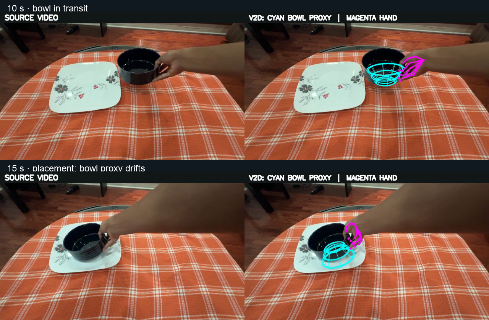
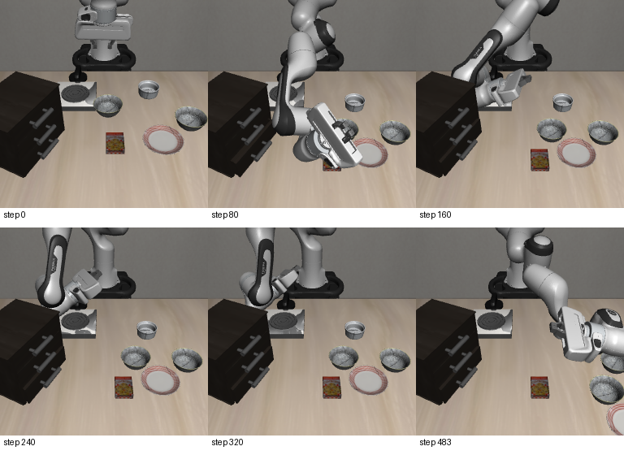

*Left: my phone recording at 2× speed. Right: LIBERO replay guided by V2D's bowl track, with an official demonstration supplying grasp and release.*

# Phone Video to LIBERO Bowl Placement

A Humanoid internship take-home experiment: use my own bowl-to-plate video to guide a robot in simulation. The 2D video-guided and V2D 3D object-guided transport variants each succeeded on **5/5 of the same official LIBERO initial states**. These are controlled replays, not a trained policy.


## See the reconstruction



*Source video is on the left of each frame. On the right, cyan is V2D's approximate 14 cm bowl mesh and magenta is its MANO hand pose, projected onto the input video. The bowl proxy visibly drifts during placement. The full source MOV, hand trajectory, and licensed MANO assets remain local.*

## See the robot result

| 2D video-guided transport | V2D 3D object-guided transport |
|:---:|:---:|
|  |  |

Both variants use the [same expert demonstration](https://github.com/Lifelong-Robot-Learning/LIBERO) for grasp and release, then replace the transport actions. [Watch a short excerpt of my recording](docs/media/IMG_7805_excerpt.mp4).

| Same five initial states | Success | Mean control steps |
|---|---:|---:|
| 2D video-guided transport | 5/5 | 197.4 |
| V2D 3D object-guided transport | 5/5 | 197.8 |
| Unmodified official expert actions | 5/5 | 98.0 |

Success is LIBERO's `env.check_success()`. The expert is faster on these states. [Per-episode metrics and setup](docs/results.md).

## What did not work yet



The direct V2D MANO-wrist-to-robot replay failed **0/1**: the gripper missed the bowl. Wrist-to-tool pose and workspace yaw need calibration. The successful variants above guide only transport; no policy fine-tuning or generalization evaluation has been run.

## Run the tested replay

Requires a Linux LIBERO installation and its `libero_spatial` demonstration HDF5. From this repository:

```bash
export PYTHONPATH=/absolute/path/to/LIBERO:$PWD
export MUJOCO_GL=egl
python scripts/video_guided_replay.py \
  --config configs/target.yaml \
  --expert-hdf5 /absolute/path/to/pick_up_the_black_bowl_from_table_center_and_place_it_on_the_plate_demo.hdf5 \
  --mode video --episodes 5 --out-dir data/video_guided_replay
```

For the 3D object track, use `--mode v2d` and a separate `--out-dir`; for the control, use `--mode expert`. [Full reproduction guide](docs/reproduction.md).

## Project files

- [`data/derived/`](data/derived/): inspected 2D waypoints and exported V2D 3D bowl track.
- [`scripts/`](scripts/): reconstruction wrapper, LIBERO replays, export, and dataset conversion.
- [`v2d_to_libero/`](v2d_to_libero/): experimental MANO extraction and robot retargeting.
- [`docs/results.md`](docs/results.md) and [`docs/design.md`](docs/design.md): evaluation, failures, design decisions.

Built with [NVIDIA V2D](https://github.com/nvidia-isaac/video_to_data) and [LIBERO](https://github.com/Lifelong-Robot-Learning/LIBERO). The repo is MIT licensed; V2D-derived code retains its Apache-2.0 headers (see [`NOTICE`](NOTICE)).
